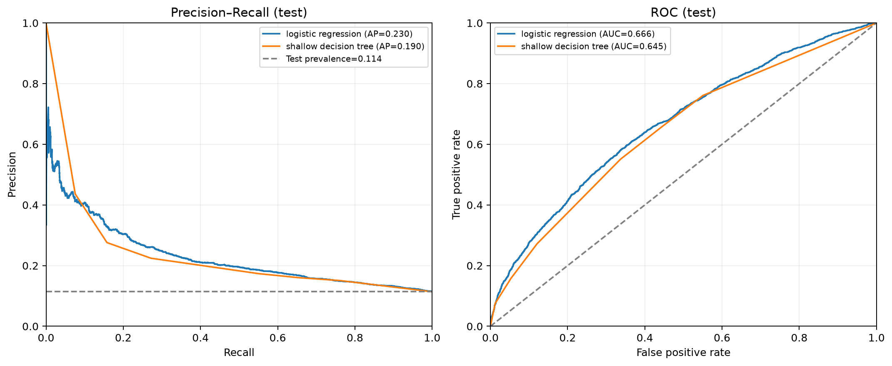
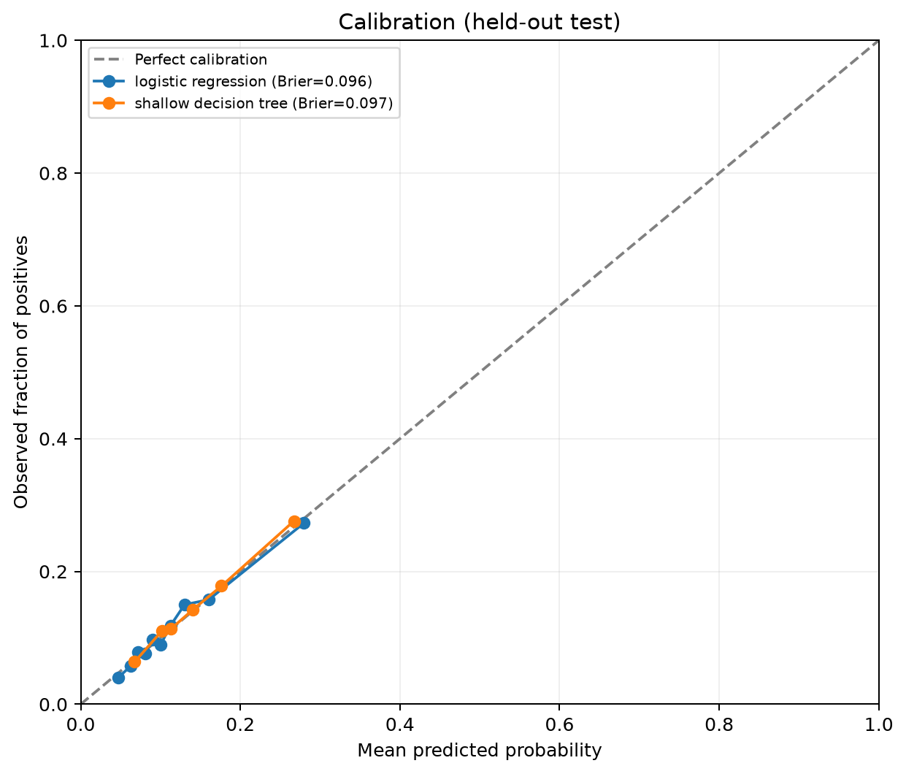

# Dự báo nhãn early-readmission `<30` theo UCI ở người bệnh đái tháo đường

## Kết luận chính

Trên tập test không trùng bệnh nhân với train/validation, mô hình có Average Precision cao hơn là **Logistic Regression** (0.230), so với prevalence baseline 0.114. Logistic Regression đạt precision 19.7% và recall 48.4% tại threshold được chọn trên validation; Decision Tree nông đạt lần lượt 17.4% và 55.1%. Đây là kết quả dự báo ở dữ liệu lịch sử, không phải bằng chứng cho thấy can thiệp dựa trên mô hình sẽ cải thiện sức khỏe.

## Dữ liệu và cách xác định cohort

Nguồn là [UCI Diabetes 130-US Hospitals for Years 1999–2008](https://archive.ics.uci.edu/dataset/296/diabetes+130-us+hospitals+for+years+1999-2008), ghi công [Clore et al. (2014), DOI 10.24432/C5230J](https://doi.org/10.24432/C5230J). Dữ liệu gốc có 101,766 encounter và 71,518 bệnh nhân; 16,773 người có nhiều encounter. Mỗi hàng phân tích là một encounter.

Outcome được giữ đúng nhãn UCI: `<30` = 1, còn `>30` hoặc `NO` = 0. Cohort chính có **99,340 encounter**, trong đó 11,312 nhãn `<30` (11.4%). Loại 1,652 disposition tử vong, 771 hospice và cả 3 encounter mã 12 (“still patient/expected outpatient return”): không encounter mã 12 nào được giữ vì chưa thể hiện lần xuất viện hoàn tất. Không chạy sensitivity riêng bằng cách thêm lại ba encounter này. Các encounter chuyển viện vẫn được giữ; transfer có thể là tiếp nối cùng đợt điều trị nên phải diễn giải thận trọng.

Bài báo gốc xác định nhãn dựa trên lần inpatient đầu tiên tiếp theo được ghi nhận sau xuất viện. Dữ liệu từ nhà cung cấp ngoài mạng lưới không được quan sát. Nhãn `<30` vì vậy không nhất thiết là tái nhập viện không kế hoạch, không phải chỉ số risk-adjusted/CMS và không thể đồng nhất với mọi định nghĩa 30 ngày khác.

## Thiết kế mô hình

Các trường nhận diện `encounter_id` và `patient_nbr` không được dùng làm predictor; `patient_nbr` chỉ dùng để chia nhóm. Nhóm chẩn đoán ICD-9 được gom thành phạm trù rộng. `weight` bị loại do thiếu rất nhiều dữ liệu; `payer_code` bị loại vì tính hành chính/khả năng khái quát thấp. `gender` và `race` bị loại khỏi đặc trưng của tất cả mô hình chính; chúng chỉ được dùng để audit subgroup trên dự đoán của Logistic Regression không nhận các thuộc tính này làm đầu vào. `age` vẫn là predictor và cũng được dùng để chia nhóm audit. Không dùng outcome để tạo đặc trưng.

Dùng `StratifiedGroupKFold` xấp xỉ 60/20/20: train 59,602, validation 19,870, test 19,868. Mỗi bệnh nhân chỉ nằm trong một split. Không có ngày nhập/xuất viện phù hợp để làm time split; kết quả không chứng minh mô hình hoạt động tốt trên bệnh viện hoặc giai đoạn khác.

So sánh baseline xác suất prevalence của train, Logistic Regression và cây quyết định giới hạn depth=3. Imputation và one-hot encoding được fit bên trong pipeline trên train. Với mỗi mô hình học được, threshold tối đa hóa F1 trên validation; test chỉ được đánh giá sau khi threshold đã cố định. Không áp dụng class weighting mặc định, vì mục tiêu là giữ xác suất và đánh giá calibration dễ diễn giải hơn.

## Kết quả trên test

| Mô hình | AP / PR-AUC | ROC-AUC | Precision | Recall | Specificity | F1 | Brier ↓ |
|---|---:|---:|---:|---:|---:|---:|---:|
| Baseline tỷ lệ nền | 0.114 | 0.500 | 0.0% | 0.0% | 100.0% | 0.000 | 0.101 |
| Logistic Regression | 0.230 | 0.666 | 19.7% | 48.4% | 74.7% | 0.280 | 0.096 |
| Decision Tree nông | 0.190 | 0.645 | 17.4% | 55.1% | 66.3% | 0.264 | 0.097 |

Baseline PR-AUC gần prevalence test (11.4%); đây là mốc để thấy AP của mô hình có vượt dự đoán không thông tin hay không. Brier score càng thấp càng tốt, nhưng cần đọc cùng đường calibration. Precision/recall thay đổi theo threshold; threshold tối ưu F1 ở validation không mặc nhiên là lựa chọn vận hành tốt nhất. Các metric là ước lượng điểm trên một lần chia dữ liệu, chưa kèm khoảng tin cậy.





## Giải thích mô hình

Logistic Regression là mô hình tuyến tính, dễ kiểm tra dấu và độ lớn hệ số. Các term dưới đây có hệ số tuyệt đối lớn nhất trong lần fit này; nhóm categorical được so với nhóm tham chiếu, numeric đã scale theo train. Chỉ xuất term có support tối thiểu 200 encounter trong train; các term vẫn có thể phản ánh cách mã hóa/chuyển viện và không phải yếu tố nhân quả hay khuyến nghị lâm sàng:

- `categorical__diag_2_Pregnancy-related`: hệ số -0.859, OR=0.42, support train=265 (liên hệ với odds thấp hơn trong mô hình).
- `categorical__discharge_disposition_id_Discharged/transferred to another rehab fac including rehab units of a hospital .`: hệ số +0.784, OR=2.19, support train=1,191 (liên hệ với odds cao hơn trong mô hình).
- `categorical__diag_1_Pregnancy-related`: hệ số +0.750, OR=2.12, support train=437 (liên hệ với odds cao hơn trong mô hình).
- `categorical__discharge_disposition_id_Discharged/transferred to a long term care hospital.`: hệ số -0.682, OR=0.51, support train=236 (liên hệ với odds thấp hơn trong mô hình).
- `categorical__discharge_disposition_id_Discharged/transferred to another type of inpatient care institution`: hệ số +0.548, OR=1.73, support train=715 (liên hệ với odds cao hơn trong mô hình).
- `categorical__discharge_disposition_id_Discharged to home`: hệ số -0.507, OR=0.60, support train=36,247 (liên hệ với odds thấp hơn trong mô hình).
- `categorical__discharge_disposition_id_Not Mapped`: hệ số -0.499, OR=0.61, support train=598 (liên hệ với odds thấp hơn trong mô hình).
- `categorical__medical_specialty_ObstetricsandGynecology`: hệ số -0.407, OR=0.67, support train=409 (liên hệ với odds thấp hơn trong mô hình).
- `categorical__medical_specialty_Surgery-Cardiovascular/Thoracic`: hệ số -0.399, OR=0.67, support train=381 (liên hệ với odds thấp hơn trong mô hình).
- `categorical__diag_2_Unknown`: hệ số +0.394, OR=1.48, support train=210 (liên hệ với odds cao hơn trong mô hình).

Cây nông dễ chuyển thành luật; mỗi lá dưới đây nêu tỷ lệ dương tính trong train, số encounter ở lá và quyết định theo threshold F1 đã chọn trên validation. Đây không phải xác suất đã được xác nhận độc lập, và cây có thể nhạy với mẫu train:

```text
Tỷ lệ ở mỗi lá ước lượng từ train; gắn cờ nếu tỷ lệ nhãn <30 >= threshold chọn trên validation (0.140).
NẾU số lần nhập viện nội trú năm trước <= 1 VÀ nơi ra viện là “về nhà”: không VÀ nơi ra viện là “chuyển về nhà có dịch vụ chăm sóc tại nhà”: không THÌ tỷ lệ nhãn <30 trong train=0.140; số encounter train ở lá=13,031; GẮN CỜ.
NẾU số lần nhập viện nội trú năm trước <= 1 VÀ nơi ra viện là “về nhà”: không VÀ nơi ra viện là “chuyển về nhà có dịch vụ chăm sóc tại nhà”: có THÌ tỷ lệ nhãn <30 trong train=0.102; số encounter train ở lá=6,294; không gắn cờ.
NẾU số lần nhập viện nội trú năm trước <= 1 VÀ nơi ra viện là “về nhà”: có VÀ số lần nhập viện nội trú năm trước <= 0 THÌ tỷ lệ nhãn <30 trong train=0.068; số encounter train ở lá=25,360; không gắn cờ.
NẾU số lần nhập viện nội trú năm trước <= 1 VÀ nơi ra viện là “về nhà”: có VÀ số lần nhập viện nội trú năm trước >= 1 THÌ tỷ lệ nhãn <30 trong train=0.113; số encounter train ở lá=6,372; không gắn cờ.
NẾU số lần nhập viện nội trú năm trước >= 2 VÀ số lần nhập viện nội trú năm trước <= 4 VÀ số lần nhập viện nội trú năm trước <= 2 THÌ tỷ lệ nhãn <30 trong train=0.176; số encounter train ở lá=4,380; GẮN CỜ.
NẾU số lần nhập viện nội trú năm trước >= 2 VÀ số lần nhập viện nội trú năm trước <= 4 VÀ số lần nhập viện nội trú năm trước >= 3 THÌ tỷ lệ nhãn <30 trong train=0.228; số encounter train ở lá=2,945; GẮN CỜ.
NẾU số lần nhập viện nội trú năm trước >= 2 VÀ số lần nhập viện nội trú năm trước >= 5 THÌ tỷ lệ nhãn <30 trong train=0.357; số encounter train ở lá=1,220; GẮN CỜ.
```

## Kiểm tra nhóm và giới hạn

Bảng tổng hợp hiện có 15 nhóm (mỗi nhóm tối thiểu 200 encounter); xem `../outputs/tables/subgroup_metrics.csv`. Đây là kiểm tra sơ bộ theo giới, chủng tộc, tuổi tại cùng threshold của Logistic Regression; gender/race chỉ được dùng cho audit, không làm predictor. Kiểm tra này không phải chứng nhận công bằng; nhóm nhỏ bị ẩn. Bộ dữ liệu cũ (1999–2008), chỉ gồm bệnh nhân đái tháo đường ở các cơ sở Hoa Kỳ, có missingness và thiên lệch ghi nhận. Chưa có external validation, chưa có đánh giá prospective, không thể theo dõi readmission ngoài hệ thống; chuyển viện và các biến cố cạnh tranh cần nghiên cứu riêng.

Đây là prototype giáo dục/nghiên cứu cho portfolio, không dùng cho chăm sóc lâm sàng và chưa được kiểm định/validated tại Việt Nam. Muốn cân nhắc ứng dụng ở bất kỳ cơ sở nào phải kiểm tra cohort/nhãn tại chỗ, đánh giá ngoài mẫu và theo thời gian, sai số và calibration theo nhóm, chọn threshold dựa trên nguồn lực và tác hại của cảnh báo sai/bỏ sót, rồi được hội đồng chuyên môn và quản trị dữ liệu phê duyệt.

## Tài liệu tham khảo

- Clore, J., Cios, K., DeShazo, J., & Strack, B. (2014). *Diabetes 130-US Hospitals for Years 1999–2008* [Dataset]. UCI Machine Learning Repository. [DOI 10.24432/C5230J](https://doi.org/10.24432/C5230J).
- Strack, B. et al. (2014). “Impact of HbA1c Measurement on Hospital Readmission Rates: Analysis of 70,000 Clinical Database Patient Records.” *BioMed Research International*, Article ID 781670. [DOI 10.1155/2014/781670](https://doi.org/10.1155/2014/781670).
